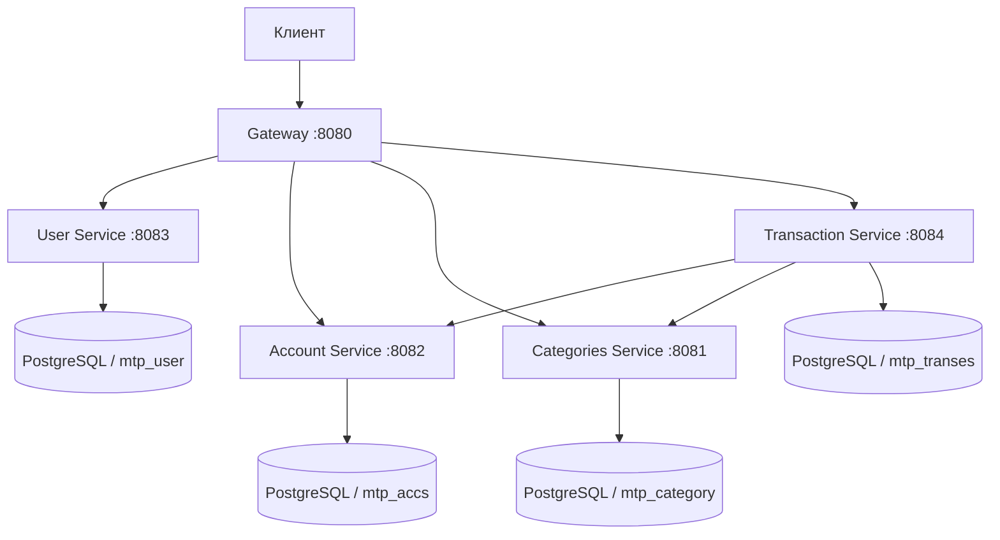

# Money Talks Project

**Money Talks Project (MTP)** — распределённая backend-система для учёта личных
финансов: пользователи ведут счета, категории доходов и расходов, создают
транзакции и переводят деньги между счетами.

Проект собран как учебно-продуктовая микросервисная система: отдельные сервисы
отвечают за пользователей, счета, категории и транзакции, а gateway скрывает
внутреннюю топологию и берёт на себя аутентификацию.

## Что демонстрирует проект

- доменную декомпозицию на четыре бизнес-сервиса и общий модуль контрактов;
- Spring Cloud Gateway и маршрутизацию с пробросом контекста пользователя;
- JWT-аутентификацию на gateway и BCrypt-хэширование паролей;
- межсервисные вызовы через OpenFeign с fallback и Resilience4j;
- повторные попытки исполнения ордера и контроль его статуса;
- транзакционное изменение балансов с уровнем изоляции `SERIALIZABLE`;
- PostgreSQL со схемой на сервис и миграциями Liquibase;
- единый формат ошибок, MDC-контекст и общий обработчик исключений.

## Архитектура



Сервисы используют одну базу `mtp_dev`, но каждый — собственную схему. Между
собой сервисы общаются по HTTP; общей шины сообщений и service discovery нет:
адреса задаются переменными окружения.

## Сервисы

| Сервис | Репозиторий | Ответственность | Порт |
|---|---|---|---|
| Gateway | [mtp-backend-ms-gateway](https://github.com/Sun1tAr/mtp-backend-ms-gateway) | Маршрутизация, JWT, регистрация и вход | 8080 |
| User | [mtp-backend-ms-user](https://github.com/Sun1tAr/mtp-backend-ms-user) | Пользователи и хэши паролей | 8083 |
| Account | [mtp-backend-ms-account](https://github.com/Sun1tAr/mtp-backend-ms-account) | Счета, балансы, исполнение ордеров | 8082 |
| Categories | [mtp-backend-ms-cathegories](https://github.com/Sun1tAr/mtp-backend-ms-cathegories) | Категории доходов и расходов | 8081 |
| Transaction | [mtp-backend-ms-transaction](https://github.com/Sun1tAr/mtp-backend-ms-transaction) | Транзакции и оркестрация операций | 8084 |
| Commons | [mtp-backend-commons](https://github.com/Sun1tAr/mtp-backend-commons) | DTO, ошибки, заголовки, контекст запроса | — |
| Root | [mtp-backend-root](https://github.com/Sun1tAr/mtp-backend-root) | Родительский Maven POM | — |

## Сценарий транзакции

1. Клиент отправляет запрос на gateway с JWT.
2. Gateway проверяет токен и передаёт в сервис транзакций `X-User-ID`.
3. Сервис транзакций проверяет `amount`, тип операции и существование счетов и
   категорий через Feign-клиенты.
4. Создаются `Transaction` и связанный `Order` в статусе `CREATED`.
5. Ордер переводится в `EXECUTING`; сервис счетов сохраняет его в статусе
   `CREATED`, меняет балансы в транзакции `SERIALIZABLE` и ставит `EXECUTED`.
6. При сбое сервис транзакций опрашивает статус ордера и повторяет исполнение
   до трёх раз с паузой в секунду.
7. История транзакций собирается с названиями счетов и категорий из
   соответствующих сервисов.

Подробнее: [docs/transaction-flow.md](docs/transaction-flow.md).

## Технологии

- Java 21, Spring Boot 4.0.1, Spring Cloud 2025.1.0/2025.1.3;
- Spring Web MVC, Spring Data JPA, Spring Security;
- PostgreSQL, Liquibase;
- OpenFeign, OkHttp, Resilience4j;
- JWT (JJWT 0.12.3), BCrypt;
- MapStruct, Lombok;
- Maven Wrapper;
- Testcontainers и Spring Boot Test.

## Документация

| Документ | Содержание |
|---|---|
| [docs/architecture.md](docs/architecture.md) | Компоненты и связи |
| [docs/services.md](docs/services.md) | Карта сервисов |
| [docs/transaction-flow.md](docs/transaction-flow.md) | Сценарий проведения операции |
| [docs/decisions.md](docs/decisions.md) | Инженерные решения |
| [MTP-docs](https://github.com/Sun1tAr/MTP-docs) | Аналитика, use cases, BPMN, схемы и рабочие заметки |

`MTP-docs` — отдельный архив проектной документации: требования,
пользовательские сценарии, бизнес-процессы и технические решения.

## Локальный запуск

Требования: JDK 21, PostgreSQL, Maven Wrapper в каждом репозитории.

1. Создайте базу `mtp_dev` и схемы `mtp_user`, `mtp_accs`, `mtp_category`,
   `mtp_transes`.
2. Установите родительский POM и общий модуль:

   ```bash
   cd mtp-backend-root && ./mvnw install
   cd ../mtp-backend-commons && ./mvnw install
   ```

3. Запустите сервисы (каждый в своём терминале):

   ```bash
   cd mtp-backend-ms-user        && ./mvnw spring-boot:run   # 8083
   cd mtp-backend-ms-account     && ./mvnw spring-boot:run   # 8082
   cd mtp-backend-ms-cathegories && ./mvnw spring-boot:run   # 8081
   cd mtp-backend-ms-transaction && ./mvnw spring-boot:run   # 8084
   cd mtp-backend-ms-gateway     && ./mvnw spring-boot:run   # 8080
   ```

4. Проверьте регистрацию и вход:

   ```bash
   curl -X POST http://localhost:8080/auth/register \
     -H "Content-Type: application/json" \
     -d '{"login":"user","password":"password"}'
   ```

Параметры подключения к БД и секрет JWT задаются переменными окружения. Значения
в `application.yml` — локальные заглушки, их нельзя использовать в реальном
окружении.

## Что важно знать

- Spring Boot 4 и Spring Cloud 2025 требуют JDK 21; на старых JDK сборка не
  запустится.
- У сервисов нет Docker Compose и CI: запуск и проверка выполняются локально
  через Maven Wrapper.
- Схемы PostgreSQL нужно создать заранее: Liquibase управляет таблицами, но не
  создаёт сами схемы.
- В `application.yml` gateway адрес пользовательского сервиса читается из
  переменной `ACCOUNT_SERVICE_URI`; это ограничение текущей конфигурации.
- Примеры в каталогах `http-request`/`http-requests` — ручные сценарии, часть из
  них может отставать от актуальных путей API. Источник истины — контроллеры.

## Репозитории

- [mtp-backend-root](https://github.com/Sun1tAr/mtp-backend-root)
- [mtp-backend-commons](https://github.com/Sun1tAr/mtp-backend-commons)
- [mtp-backend-ms-gateway](https://github.com/Sun1tAr/mtp-backend-ms-gateway)
- [mtp-backend-ms-user](https://github.com/Sun1tAr/mtp-backend-ms-user)
- [mtp-backend-ms-account](https://github.com/Sun1tAr/mtp-backend-ms-account)
- [mtp-backend-ms-cathegories](https://github.com/Sun1tAr/mtp-backend-ms-cathegories)
- [mtp-backend-ms-transaction](https://github.com/Sun1tAr/mtp-backend-ms-transaction)
- [MTP-docs](https://github.com/Sun1tAr/MTP-docs)
