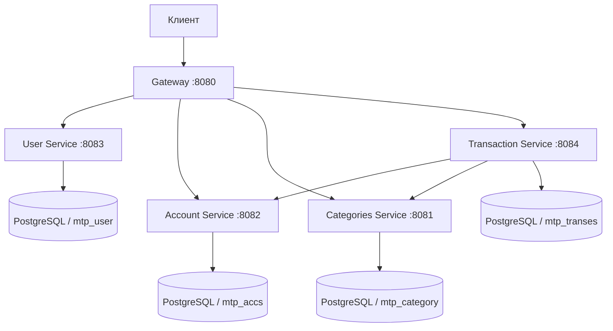

# Архитектура Money Talks Project

Сервисы разделены по бизнес-областям и используют одну базу `mtp_dev`, но каждый
свою схему. Gateway скрывает внутреннюю топологию от клиента, проверяет JWT и
передаёт сервисам `X-User-ID`; межсервисные вызовы оформлены через typed clients
(OpenFeign) с fallback-обработкой.

## Архитектурные акценты

- доменная декомпозиция на пользователей, счета, категории и операции;
- единый модуль общих контрактов (`mtp-backend-commons`) и родительский POM;
- миграции базы через Liquibase, схема на сервис;
- межсервисные вызовы через OpenFeign и OkHttp;
- обработка отказов через fallback и Resilience4j CircuitBreaker;
- отдельный gateway с JWT-аутентификацией и stateless-сессией;
- исполнение ордера в транзакции `SERIALIZABLE` с повторными попытками.

## Ограничения текущей реализации

- нет service discovery и шины сообщений: адреса сервисов задаются переменными
  окружения;
- нет Docker Compose и CI: сборка и запуск выполняются локально через Maven
  Wrapper;
- схемы PostgreSQL создаются заранее, Liquibase управляет только таблицами.
