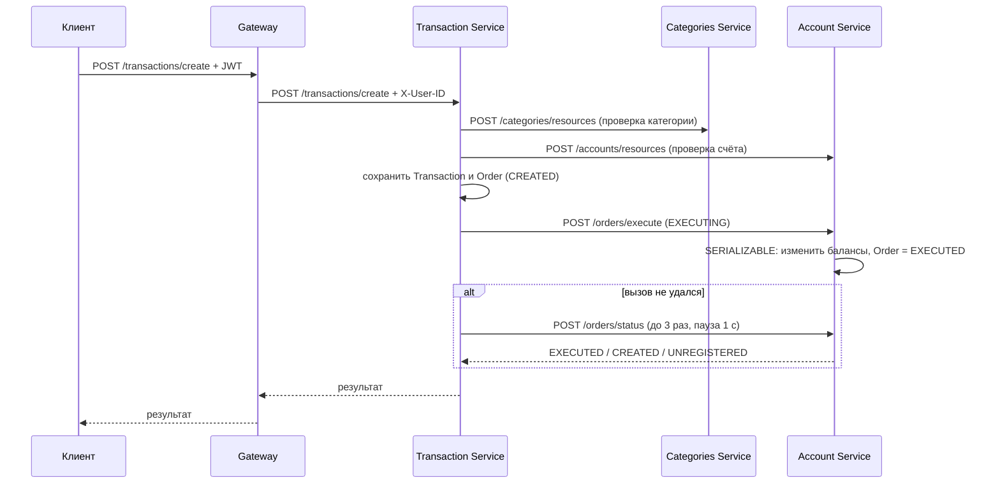

# Сценарий создания транзакции

## Шаги

1. Клиент отправляет запрос через Gateway с JWT. Gateway проверяет токен, кладёт
   идентификатор пользователя в `SecurityContext` и передаёт его в Transaction
   Service заголовком `X-User-ID`.
2. Transaction Service проверяет `amount` (должен быть больше нуля) и тип операции,
   затем запрашивает названия и принадлежность ресурсов через
   `POST /accounts/resources` и `POST /categories/resources`.
3. Создаются `Transaction` и связанный `Order` в статусе `CREATED`; они
   сохраняются одной транзакцией.
4. `OrderExecutorService` переводит ордер в `EXECUTING` и вызывает
   `POST /orders/execute`.
5. Account Service в транзакции с уровнем изоляции `SERIALIZABLE` сначала
   сохраняет ордер, затем пересчитывает балансы и переводит ордер в `EXECUTED`.
6. Если вызов не удался, Transaction Service до `ms.order-executor.max-retry-counts`
   раз (по умолчанию 3) опрашивает `POST /orders/status` с паузой
   `ms.order-executor.retry-delay-ms` (по умолчанию 1000 мс):
   - `EXECUTED` — операция завершена;
   - `UNREGISTERED` — ордер не дошёл, отправляется повторно;
   - `CREATED` — ожидание и повторный опрос.
7. При успехе транзакция и ордер переводятся в `EXECUTED`.
8. `GET /transactions` собирает UUID счетов и категорий и запрашивает их названия
   через `resources`-эндпоинты, после чего отдаёт клиенту объединённую модель.

## Ошибки

- `TRANSACTION_AMOUNT_INVALID` — сумма не больше нуля;
- `ACCOUNT_NOT_FOUND`, `CATEGORY_NOT_FOUND` — ресурс не существует или принадлежит
  другому пользователю;
- при недоступности зависимого сервиса Fallback-фабрика возвращает доменную ошибку
  с заголовком `X-Error-Code`, поэтому вызывающий код отличает недоступность от
  бизнес-ошибки.

Подробные BPMN-схемы и аналитические материалы находятся в `MTP-docs`.
